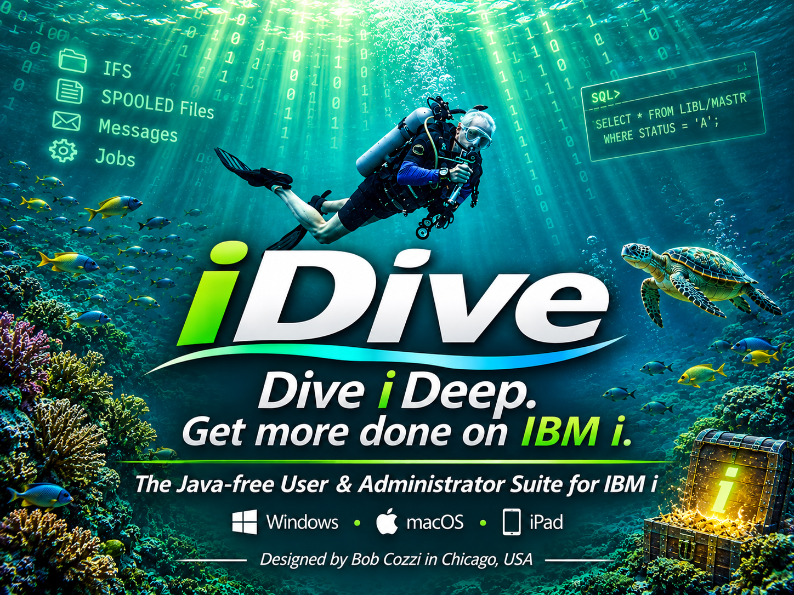

# iDive for IBM i

A desktop SQL and CL client for IBM i by Bob Cozzi. iDive continues the
IBMi-RUNSQL product line (last release 2.0.7) under a new name, starting at
version 1.0.0.

This public repository contains release downloads, user information, and the
changelog. Application source code and ongoing development are maintained in a
private repository.

## Downloads

Download installers and executables from
[GitHub Releases](https://github.com/bobcozzi/IBMi-iDive/releases).

| Platform             | Release                                                                             |
| -------------------- | ----------------------------------------------------------------------------------- |
| macOS, Apple Silicon | [1.0.0 macOS](https://github.com/bobcozzi/IBMi-iDive/releases/tag/v1.0.0-macos)     |
| Windows, x64         | [1.0.0 Windows](https://github.com/bobcozzi/IBMi-iDive/releases/tag/v1.0.0-windows) |

Choose the `.dmg` or `.zip` under the release's **Assets** section. SHA-256
files are attached to each release.

The macOS application ZIP and DMG are signed, notarized, and stapled. The
Windows executable is unsigned and cross-compiled; it has **not been
runtime-tested on Windows**. Extract the ZIP before launching the executable;
Microsoft Edge WebView2 Runtime is required.

iPad support remains private development only. No public iPad asset is provided.

  

## Features

- SQL scripts and results, CL commands and prompting, result exports, and SQL
  INSERT/UPDATE copy.
- Spooled files (SCS and AFPDS viewing), IFS browsing, message queues and
  inquiry replies, and Admin panels.
- Auto Recall of the editor session, saved to the IBM i IFS (`/iDive` folder in
  your home directory) or to the local PC only. With several connections to
  the same host, only the first uses the host copy; the others keep local
  scripts, and Connections > Load Script from Host pulls the host script in on
  demand.
- Connects directly to IBM i with Go. Java is not required.

Host feature availability depends on IBM i release, PTF levels, configuration,
and authority.

## Multiple Connections and Auto Recall

Auto Recall keeps the SQL/CL script for each connection between sessions.

- The first connection to a host and user saves its script on the IBM i host
  (`/iDive` folder in your home directory) and loads it when you connect. If
  the host has no saved script, the copy on your PC is used.
- If you open a second connection to the same host, the last saved script is
  not loaded from the host. Each additional connection keeps its own script
  on your PC and starts empty when it has none.
- To pull the host's saved script into a connection on demand, choose
  Connections > Load Script from Host.
- Disconnect and Reconnect, also on the Connections menu, apply to the active
  connection. A reconnect keeps its connection number.

## Requirements

- An IBM i user profile and network access to the IBM i host servers.
- Windows requires Microsoft Edge WebView2 Runtime.

## Upgrading from IBMi-RUNSQL

iDive uses its own application name and identifier. On first launch it migrates
saved connections, settings, statement history and saved passwords from
IBMi-RUNSQL where they are available. Interface preferences stored by the
macOS app (theme, fonts, colors) start at their defaults. The old app can be
removed after you confirm your connections.

The earlier releases remain at
[bobcozzi/open-runsql](https://github.com/bobcozzi/open-runsql).

## Release History

See [CHANGELOG.md](CHANGELOG.md). Binaries are distributed as release assets,
not committed to the repository's Git tree.

## Privacy

See the [privacy policy](PRIVACY.md). iDive sends your data only to the IBM i systems you connect to.

## Source Availability

Current application source code is private. This repository's Git history and
release tags contain distribution documentation only.
